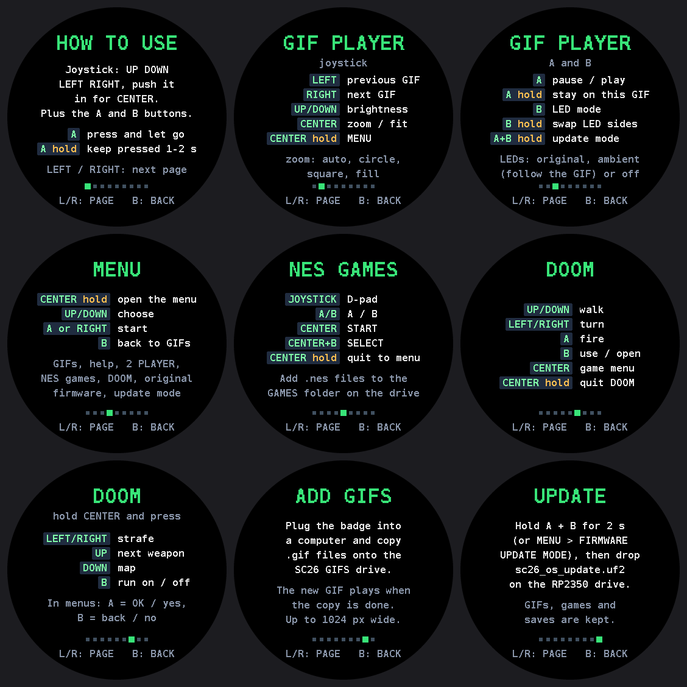

# SC26 OS v2.1 by BP

Custom firmware for the **SAINTCON 2026 rocket badge** (RP2350, round 360×360 screen, 9 LEDs, 7 buttons).

- **Animated GIF player.** Drop GIFs on the badge's USB drive and they play. The LEDs can copy the colours at the edge of the picture.
- **Boot screen.** A BIOS-style self-test, then an astronaut splash.
- **NES emulator.** Add your own `.nes` games.
- **2 PLAYER over USB-C.** Link two badges with one cable and play NES games together.
- **DOOM engine.** Add your own WAD (see below).
- **Original badge firmware**, still available from the menu.
- **On-screen help.** Menu → HOW TO USE.



## Download

Get the latest files from **[Releases](../../releases/latest)**, or from the [`firmware/`](firmware) folder:

| File | What it's for |
|---|---|
| `sc26_full_install.uf2` | **First install.** SC26 OS, the original firmware, the DOOM engine, and a fresh SC26 GIFS drive with the boot GIF. Replaces anything already on the badge's drive. |
| `sc26_os_update.uf2` | **Later updates.** SC26 OS only; keeps your GIFs, games, saves and settings. |
| `original_firmware_restore.uf2` | Puts the stock badge firmware back. |

## Installing

1. **Put the badge in update mode.** Hold the **BOOTSEL** button while you plug it into your computer. If SC26 OS is already on it, you can instead hold **A + B** for 2 seconds, or use Menu → FIRMWARE UPDATE MODE. A drive called **RP2350** appears.
2. **Drag `sc26_full_install.uf2` onto the RP2350 drive.** The copy takes about a minute. When it finishes, the badge restarts on its own. macOS may warn that the disk wasn't ejected properly; that's normal.
3. The badge runs its BIOS screen and the astronaut splash, then starts playing. A drive called **SC26 GIFS** appears on your computer.

For later updates, do the same with `sc26_os_update.uf2`.

## Using it

**Hold CENTER** (push the joystick in) for the menu. **HOW TO USE** in the menu shows every button on the badge itself.

| GIF player | |
|---|---|
| Left / Right | previous / next GIF |
| Up / Down | brightness |
| CENTER | zoom (auto, fit circle, fit square, fill) |
| hold CENTER | menu |
| A / hold A | pause / stay on this GIF |
| B / hold B | LED mode (original, ambient, off) / swap LED sides |
| hold A + B (2 s) | firmware update mode |

| NES | | DOOM | |
|---|---|---|---|
| Joystick | D-pad | Up / Down, Left / Right | walk, turn |
| A / B | A / B | A / B | fire / use, open |
| CENTER | START | CENTER | game menu |
| CENTER + B | SELECT | hold CENTER + Left/Right, Up, Down, B | strafe, next weapon, map, run |
| hold CENTER | back to the menu | hold CENTER (2 s) | quit to SC26 OS |

There's no speaker on the badge, so games are silent.

### Adding GIFs

Plug the badge in and copy `.gif` files onto the **SC26 GIFS** drive. Playback pauses while files copy, then the newest one plays. GIFs can be up to 1024 px wide; 360×360 looks best because the screen is round. `tools/gifprep.py` resizes any GIF to fit.

### Adding NES games

Copy `.nes` files (iNES format, up to 504 KB) into the **GAMES** folder on the drive, then pick them from the menu. Most US games work (mappers 0–4, 7 and many more). Only use games you own.

### 2 PLAYER (two badges, one USB-C cable)

Play NES games together, for example Contra in co-op:

1. **Connect the two badges** with a USB-C to USB-C data cable. Both run on battery; neither is plugged into a computer.
2. **Open 2 PLAYER on both:** Menu → **2 PLAYER (USB-C)**.
3. **Pick Player 1.** On that badge, press **A**. It restarts as the USB host and lists its GAMES folder. Both screens then show **LINKED TO** plus the other badge's ID.
4. **Start a game.** Player 1 picks one and both badges start it together. Player 1 is controller 1 and Player 2 is controller 2. In Contra, pick **2 PLAYERS** on the title screen with SELECT (CENTER + B).

If Player 2 doesn't have the game, Player 1 sends it over the cable and Player 2 keeps a copy in GAMES.

Hold **CENTER** on either badge to end the game for both. **B** leaves the 2 PLAYER screen; Player 1 restarts into the normal menu.

Both badges run the emulator in lockstep: every frame they swap button presses, which adds about 1/30 s of input delay. A memory check every couple of seconds shows **DESYNC** if they ever drift apart.

### Adding DOOM

The engine is installed, but no game data is included. **DOOM** appears in the menu once you add a WAD you own: registered DOOM (v1.9) or the free shareware `DOOM1.WAD`. The converted file has to fit in 6 MB.

1. Build `whd_gen` from [rp2040-doom](https://github.com/kilograham/rp2040-doom). It's a normal native CMake build, and the tool ends up at `src/whd_gen/whd_gen`.
2. Convert your WAD: `whd_gen DOOM.WAD doom.whd -no-super-tiny`. Registered DOOM comes out at about 5.7 MB.
3. Make an installer: `python3 tools/make_combined_uf2.py doom_data.uf2 --whd doom.whd`.
4. Put the badge in update mode and drag `doom_data.uf2` onto it. Everything else on the badge stays.

## Flash map (16 MB)

| Offset | Size | Contents |
|---|---|---|
| `0x000000` | 1 MB | SC26 OS |
| `0x100000` | 1.5 MB | Original badge firmware |
| `0x280000` | 508 KB | NES ROM cache |
| `0x2FF000` | 4 KB | Settings |
| `0x300000` | 512 KB | DOOM engine |
| `0x380000` | 6 MB | DOOM game data (WHD) + save games |
| `0x980000` | 6.5 MB | SC26 GIFS USB drive |

## Building from source

The repo is laid out like this:

- **`fw/`**: SC26 OS. The GIF player, menu and boot screen are in `fw/gifplayer`, the badge drivers in `fw/common`, the NES glue in `fw/nes`, and the libraries in `fw/lib`.
- **`p3/rp2040-doom/`** and **`docs/rp2040-doom-sc26.patch`**: the DOOM port.
- **`tools/`**: asset, GIF and installer scripts.
- **`boot/`**: the splash artwork.
- **`docs/`**: hardware and design notes.
- **`re/`**: the emulator used for testing.

**SC26 OS** needs pico-sdk 2.3.1 and arm-none-eabi-gcc:

```
cd fw && mkdir build && cd build
PICO_SDK_PATH=/path/to/pico-sdk cmake .. -DPICO_BOARD=pico2 -DPICO_PLATFORM=rp2350-arm-s
make sc26_gif        # -> sc26_gif.bin / sc26_gif.uf2
```

**DOOM engine** is [kilograham/rp2040-doom](https://github.com/kilograham/rp2040-doom) at commit `29a453c`, plus `docs/rp2040-doom-sc26.patch`, plus `p3/rp2040-doom/src/pico/sc26_doom.[ch]`. It also needs pico-extras. Build `doom_tiny_nost` like this:

```
CFLAGS="-DPICO_AUDIO_I2S_DATA_PIN=26 -DPICO_AUDIO_I2S_CLOCK_PIN_BASE=27 -DPICO_SCANVIDEO_RP2350_OVERLAY_SDK_SPINLOCKS=1 -DPICO_AUDIO_RP2350_OVERLAY_SDK_SPINLOCKS=1" \
CXXFLAGS="$CFLAGS" cmake -G Ninja .. -DCMAKE_BUILD_TYPE=MinSizeRel -DPICO_BOARD=pico2 \
  -DPICO_PLATFORM=rp2350-arm-s -DSC26_BOARD=ON -DPICO_SDK_PATH=... -DPICO_EXTRAS_PATH=...
ninja doom_tiny_nost
```

**Installers** are built by `tools/make_release.py`; see its header for the full command. `docs/phase3-games-boot.md` covers how the boot screen, menu, NES and DOOM pieces fit together.

## Credits and licences

**SC26 OS v2.1 by BP.**

It's built on:

- **rp2040-doom** by Graham Sanderson, based on Chocolate Doom (GPL-2.0).
- **InfoNES** by Jay's Factory, via pico-infones by Shuichi Takano (GPL-3.0).
- **AnimatedGIF** by Larry Bank (Apache-2.0).
- **FatFs** by ChaN.
- The **Raspberry Pi Pico SDK** (BSD-3-Clause) and **TinyUSB** (MIT).

SC26 OS includes GPL-3.0 code, so its source and binaries are released under the **GPL-3.0** (see [`LICENSE`](LICENSE)). The DOOM engine is GPL-2.0. The original firmware image (`original_firmware_restore.uf2`, and the copy inside the full install) is the SAINTCON 2026 badge team's work and isn't covered by these licences. The other licence texts are in [`LICENSES/`](LICENSES).

No game data is included: no DOOM WADs and no NES ROMs.
